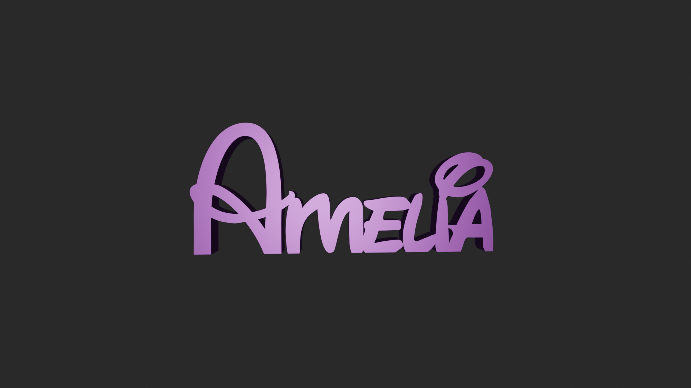

# Maker Names

**Editor web de nomes personalizados para CNC, corte a laser e impressão 3D.**

O Maker Names permite compor nomes com diferentes fontes e elementos decorativos, visualizar o resultado e exportar ficheiros SVG, DXF e STL. O projeto reúne uma interface em HTML, CSS e JavaScript, uma API em ASP.NET Core e uma biblioteca C# dedicada à geração de geometria.

[Experimentar o site](https://makernames-web-budkfba4gtg7b6df.westeurope-01.azurewebsites.net/) · [Abrir o editor](https://makernames-web-budkfba4gtg7b6df.westeurope-01.azurewebsites.net/editor.html) · [Perfil do autor](https://github.com/Ndngarcez)

## Exemplo da biblioteca



*Pré-visualização de um modelo incluído na biblioteca de downloads do projeto.*

## Funcionalidades

- Editor de nomes com seleção de fontes, cores, espaçamento e ajustes de letras.
- Composição com acessórios e elementos decorativos.
- Pré-visualização do desenho e visualização 3D.
- Exportação em **SVG**, **DXF** e **STL**.
- Biblioteca de nomes preparados para download.
- Contas de utilizador, verificação de email e recuperação de palavra-passe.
- Integrações de email por SMTP e processamento de eventos Stripe, mediante configuração.

## Tecnologias

| Área | Tecnologias |
| --- | --- |
| Interface | HTML, CSS, JavaScript |
| API | C#, ASP.NET Core, .NET 8 |
| Geometria e geração | System.Drawing.Common, LibTessDotNet |
| Dados de autenticação | Ficheiro JSON local ou SQL Server, conforme a configuração |
| Documentação da API | Swagger / OpenAPI em desenvolvimento |
| Site publicado | Azure App Service |

## Organização do código

```text
MakerNames.Api/
  Controllers/     Endpoints da API
  Services/        Contas, emails, comunidade e biblioteca
  wwwroot/         Interface web, fontes e recursos visuais
  DownloadLibrary/ Modelos disponíveis para download
MakerNames.Core/
  Generators/      Geração de nomes e exportação SVG, DXF e STL
  Geometry/        Operações de geometria
  Moldels/         Modelos de dados (nome atual da pasta)
```

A API referencia a biblioteca Core. Esta separação organiza a lógica de geração fora dos controladores e da interface web.

## Executar localmente

**Requisitos:** Windows, Git e SDK .NET 8 ou superior compatível com o destino .NET 8. A geração gráfica depende de System.Drawing e requer Windows.

```powershell
git clone https://github.com/Ndngarcez/Maker-Names.git
cd Maker-Names
dotnet restore MakerNames.Api/MakerNames.Api.csproj
dotnet build MakerNames.Api/MakerNames.Api.csproj
dotnet run --project MakerNames.Api -- --desktop
```

O modo desktop inicia o servidor e abre o editor em `http://127.0.0.1:58731/editor.html?desktop=1`.

Para executar com o perfil HTTP de desenvolvimento:

```powershell
dotnet run --project MakerNames.Api --launch-profile http
```

O site fica disponível em `http://localhost:5052` e a documentação da API em `http://localhost:5052/swagger`.

## Configuração e dados locais

O `appsettings.json` publicado contém valores de exemplo. Os serviços externos precisam das respetivas credenciais, configuradas por variáveis de ambiente ou num ficheiro local excluído do Git.

| Variável de ambiente | Finalidade |
| --- | --- |
| `Smtp__Host`, `Smtp__Port`, `Smtp__EnableSsl` | Servidor de email |
| `Smtp__UserName`, `Smtp__Password`, `Smtp__FromEmail` | Autenticação e remetente de email |
| `Notifications__AdminEmail` | Destinatário das notificações administrativas |
| `Stripe__WebhookSecret` | Validação dos eventos recebidos do Stripe |
| `GoogleSearch__ApiKey`, `GoogleSearch__Cx` | Integração de pesquisa de imagens |
| `ConnectionStrings__AuthDatabase` | Base de dados SQL Server opcional para autenticação |

Sem ligação à base de dados, o serviço de contas utiliza `App_Data/auth.json`. Sem servidor SMTP configurado, os emails são guardados localmente em `App_Data/emails`.

A pasta `App_Data`, as configurações de desenvolvimento/produção e os ficheiros de compilação estão excluídos do Git. Não publiques palavras-passe, chaves de API nem dados reais de utilizadores.

## O que este projeto demonstra

- Integração de uma interface web com uma API em C#.
- Organização do código entre apresentação, serviços e geração de geometria.
- Conversão de nomes e desenhos em formatos usados em fabricação digital.
- Implementação de fluxos de contas e integração com serviços externos.
- Configuração e disponibilização de uma aplicação web no Azure.

## Autor

**Nuno Daniel Neto Garcez** — [GitHub: Ndngarcez](https://github.com/Ndngarcez)

### Descrição curta para currículo

> Maker Names — projeto web em C# / ASP.NET Core e JavaScript para criar nomes personalizados e exportar SVG, DXF e STL para CNC, corte a laser e impressão 3D. Inclui editor visual, biblioteca de modelos e gestão de contas, com demonstração publicada no Azure.

## Modo CNC (versão local)

O editor alterna entre impressão 3D e preparação CNC, reutilizando os contornos do projeto sem converter STL em DXF. O modo CNC gera perfis 2.5D com compensação do raio da ferramenta (Clipper2), união das letras sobrepostas, preservação dos interiores e profundidades iguais por passagem. A largura final é definida explicitamente em milímetros.

Controladores: GRBL (ferramenta montada manualmente, número em comentário) e Mach3 (T/M6; depende da configuração da máquina). Exportação `.nc`, coordenadas absolutas G54, Z zero no topo do material, origem XY no canto inferior esquerdo do desenho ou centro. Não inclui compensação de comprimento da ferramenta; montar e medir a ferramenta antes de executar. Sentido horário/anti-horário aplica-se a todos os contornos; não equivale a selecionar concordante/discordante.

Pré-visualização superior do percurso e largura da fresa, com seleção da profundidade por passagem. Não é simulação de remoção volumétrica nem deteção de colisões. Entrada vertical, sem pontes, rampas ou desbaste de cavidades. A exportação bloqueia alterações na quantidade de contornos causadas pelo diâmetro; detalhes menores que a fresa podem exigir revisão. Confirmar grampos, material, origem e parâmetros, simular no controlador e ensaiar acima do material.

Verificação: `dotnet run --project MakerNames.CncChecks`. Abrir o editor, escolher CNC, configurar, calcular e descarregar. Alterações ao projeto/parâmetros invalidam o percurso. Próximos passos: pontes de fixação, rampas, material/espessura, limites de máquina, estimativa de tempo e animação da ferramenta.

### Simulador de percurso integrado

O modo CNC inclui reprodução/pausa, reinício, velocidade 1–100× e navegação temporal. O simulador interpreta os movimentos G0/G1 do próprio G-code exportado (mm absolutos), mostrando XYZ, passagem e sulcos com a largura da fresa e profundidade em cores. Começa após o primeiro posicionamento XY, pois a posição inicial real é desconhecida. É uma aproximação 2D para fresa cilíndrica; não simula colisões ou remoção volumétrica. A duração usa os avanços programados e rápidos estimados a 3000 mm/min, excluindo aceleração, spindle e troca de ferramenta. Alterar o projeto invalida também a simulação.

Testes do simulador: `node MakerNames.CncChecks/simulator.test.cjs`.

Quando o diâmetro altera a quantidade de contornos, o editor permite uma simulação de diagnóstico com aviso. O campo de exportação Gcode fica vazio e CanExport=false; SimulationGcode destina-se apenas à visualização. Não usar este percurso para produção.

O download de um percurso com alterações geométricas pode ser desbloqueado através da confirmação explícita junto ao aviso. É exportado exatamente SimulationGcode, sem modificar os parâmetros. Uma alteração ao projeto ou aos parâmetros limpa a confirmação.
